<div align="center">

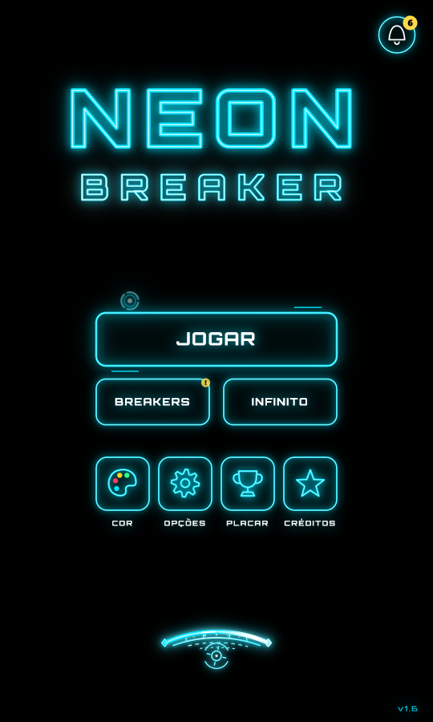

# NEON BREAKER

**Um quebra-blocos minimalista em neon, feito para o celular.**
Rebata o disco, atravesse os distritos de uma cidade cibernética e derrube O SISTEMA.


### [▶ JOGAR AGORA NO NAVEGADOR](https://costardiv1.github.io/neon-breaker/)

<sub>Funciona no celular e no PC. No celular, use “Adicionar à tela inicial” para jogar em tela cheia.</sub>

</div>

---

## Sobre o jogo

Neon Breaker é um *brick breaker* inspirado no clássico e na estética de Tron: fundo preto, uma cor de tema, linhas neon com brilho e um disco que deixa um rastro de luz. Tudo é desenhado em tempo real no canvas e todo o som é sintetizado na hora, sem nenhum arquivo de imagem ou áudio.

Os nomes dos 10 distritos contam a história de um jovem da periferia que passa as noites programando um jogo e, com ele, derruba o sistema. A crítica social é discreta: está nos nomes, nos chefões e no final.

<div align="center">
<table>
<tr>
<td align="center">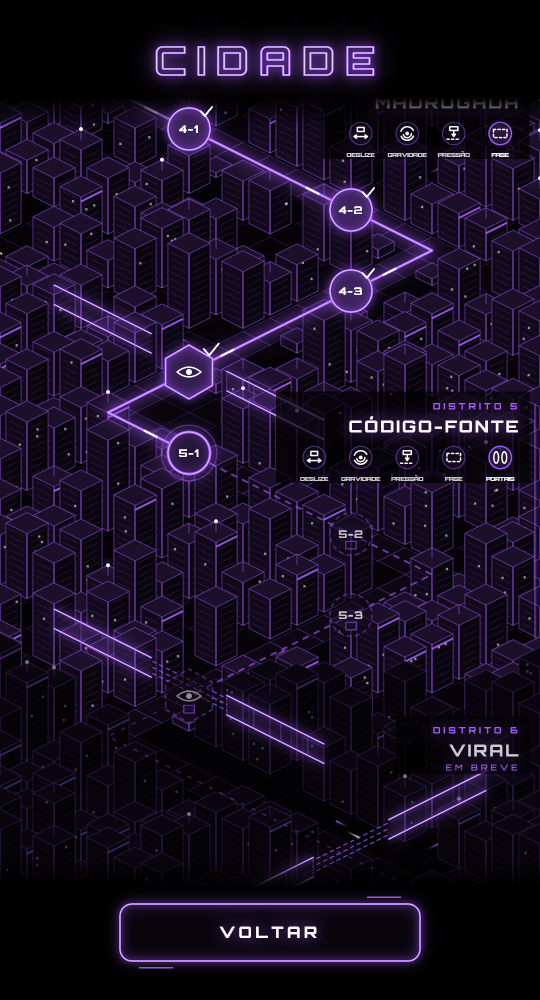<br><sub><b>O mapa</b>: uma cidade isométrica</sub></td>
<td align="center">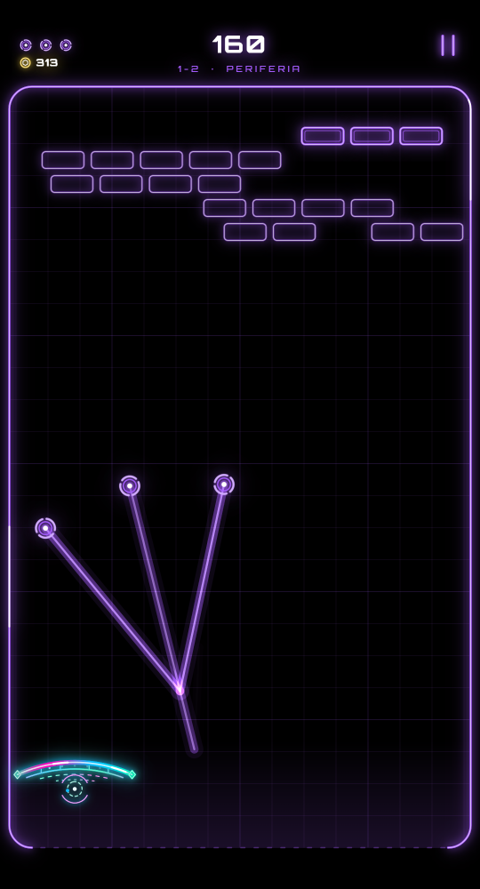<br><sub><b>Partida</b> com MULTI ativo</sub></td>
<td align="center">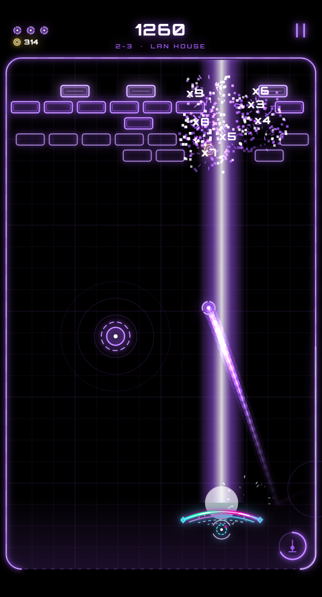<br><sub><b>MEGA LASER</b> da plataforma</sub></td>
</tr>
</table>
</div>

## Destaques

- **5 distritos jogáveis, 20 fases e 5 chefões**, cada um com dois estágios de vida e MODO FÚRIA.
- **Mecânicas que se acumulam**: cada distrito traz uma nova e mantém as anteriores.
- **Mapa em cidade 3D isométrica**: o caminho das fases é uma rua, com cercas de neon nos portões, carros de luz que passam atrás dos prédios e a torre AURUM no fim.
- **Plataforma personalizável**: 5 formatos com física própria (liberados derrotando chefões), 8 paletas, 8 emblemas, 7 discos e 7 rastros.
- **Poderes da plataforma** evoluídos com chips: MEGA LASER, ONDA DE CHOQUE, ESCUDO, ÍMÃ e PLATAFORMA LARGA.
- **12 cápsulas** de poderes e desvantagens, incluindo míssil teleguiado e o disco FANTASMA, que some perto dos blocos.
- **Animação própria ao bater** em cada formato: o ARCO salta, a LÂMINA pisca, a PONTA fica mais pontuda, a FERRADURA balança e a ASA bate as asas.
- **Trilha sonora sintetizada** por distrito, cada vez mais rápida e frenética, com a borda do campo pulsando na batida.
- **Feito para celular**: toque para levar a plataforma até o dedo, qualidade gráfica ajustável e padrões diferentes para PC e celular.
- **Modo dev secreto** (5 toques na versão + senha), com painel dentro da partida, controles deslizantes e uma aba VISUAL.

## Distritos

| # | Distrito | Mecânica nova | Chefão | |
|:-:|---|---|---|---|
| 1 | PERIFERIA | DESLIZE: as fileiras deslizam | SENTINELA | ✅ |
| 2 | LAN HOUSE | GRAVIDADE: núcleos curvam o disco | SINGULARIDADE | ✅ |
| 3 | HORA EXTRA | PRESSÃO: os blocos descem até a linha de alerta | O SUPERVISOR | ✅ |
| 4 | MADRUGADA | FASE: blocos tracejados que o disco atravessa | O RELÓGIO DE PONTO | ✅ |
| 5 | CÓDIGO-FONTE | PORTAIS: entra num, sai pelo outro | A PATENTE | ✅ |
| 6–9 | VIRAL · CENSURA · RESISTÊNCIA · TORRE AURUM | a definir | a definir | em breve |
| 10 | O SISTEMA | — | O SISTEMA | em breve |

<div align="center">
<table>
<tr>
<td align="center">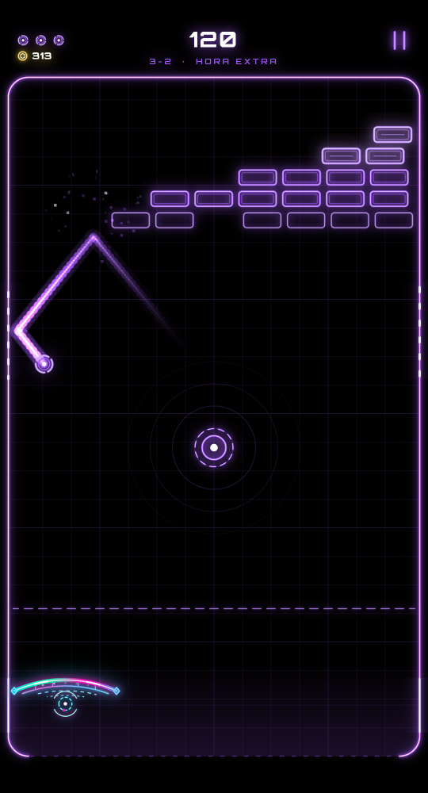<br><sub>PRESSÃO</sub></td>
<td align="center">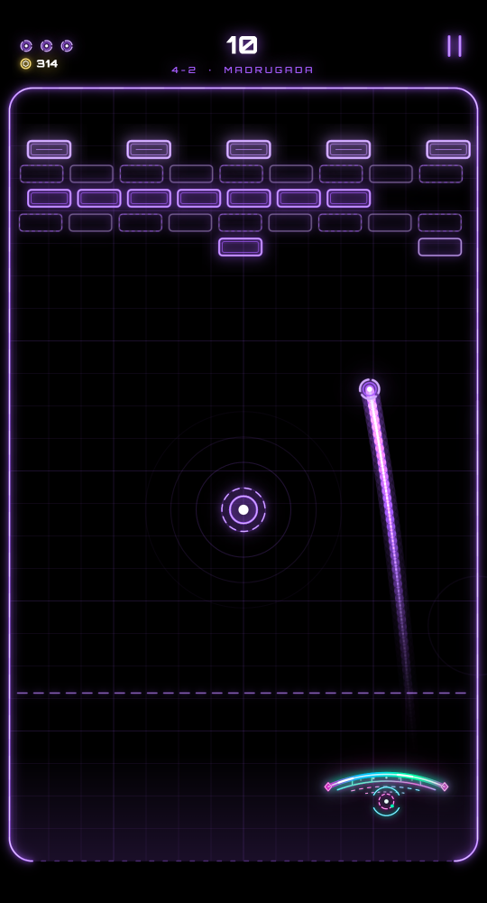<br><sub>FASE</sub></td>
<td align="center">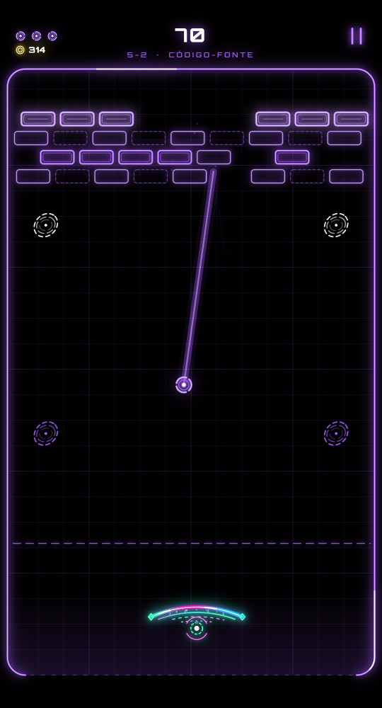<br><sub>PORTAIS</sub></td>
</tr>
</table>
</div>

## Chefões

<div align="center">
<table>
<tr>
<td align="center">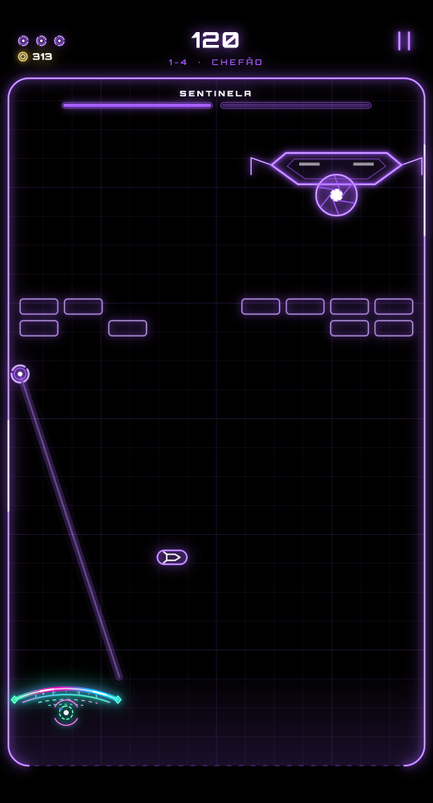<br><sub><b>SENTINELA</b><br>núcleo sob o casco</sub></td>
<td align="center">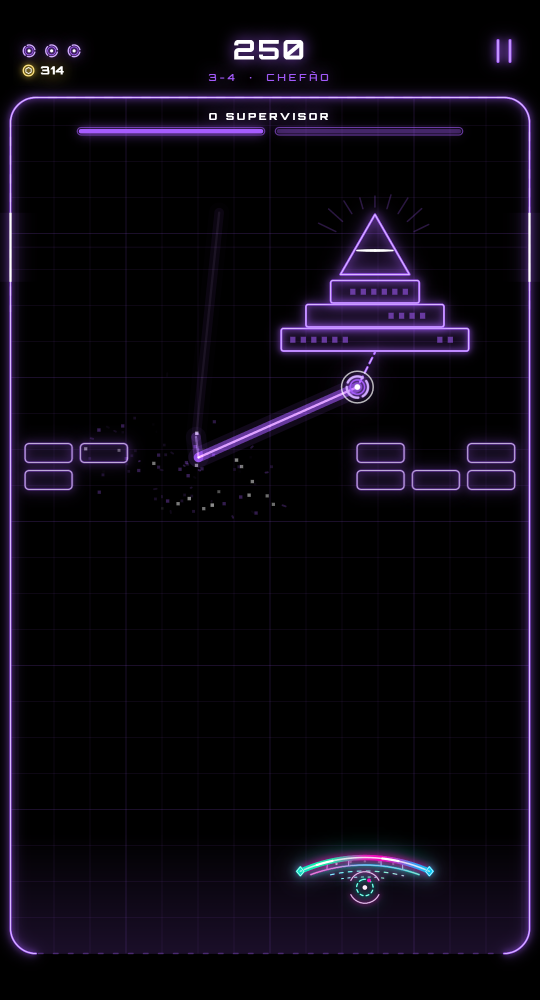<br><sub><b>O SUPERVISOR</b><br>o olho no topo da pirâmide</sub></td>
<td align="center">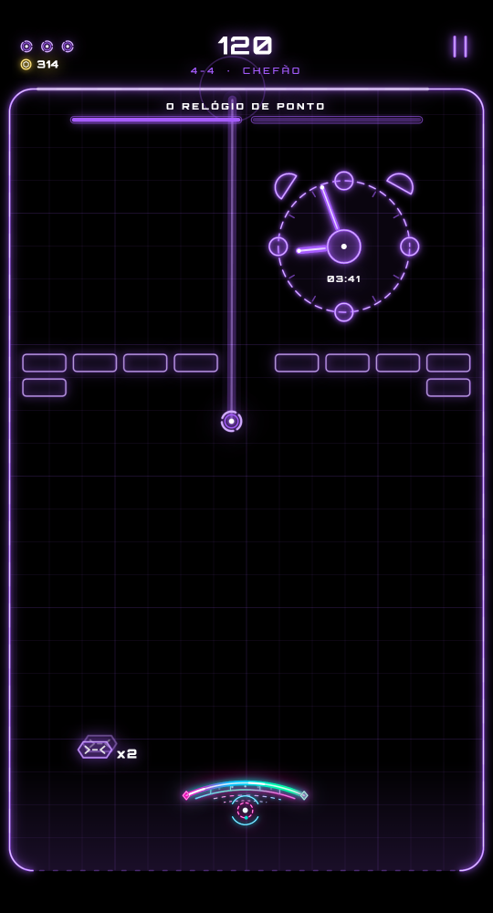<br><sub><b>O RELÓGIO DE PONTO</b><br>ponteiros que rebatem o disco</sub></td>
<td align="center">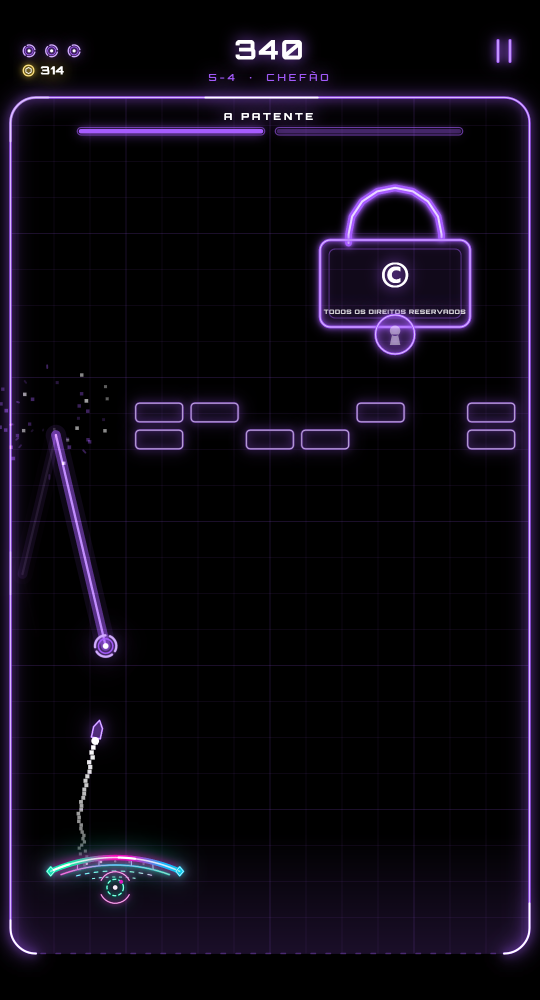<br><sub><b>A PATENTE</b><br>tranca o que é de todos</sub></td>
</tr>
</table>
</div>

<details>
<summary><b>⚠️ Spoiler: o final</b></summary>
<br>
Ao derrotar O SISTEMA, o jogo finge travar: a tela congela e se rasga, e um terminal tenta reiniciar o sistema.

<div align="center">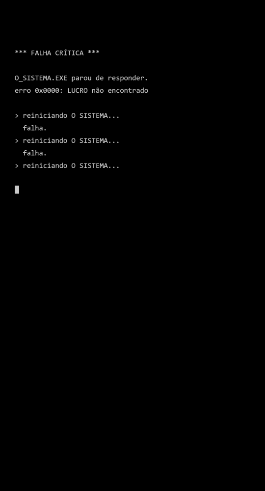 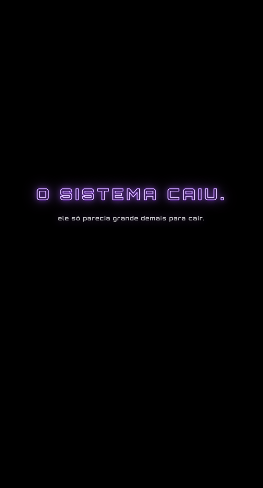</div>
</details>

## A plataforma

<div align="center">
<table>
<tr>
<td align="center">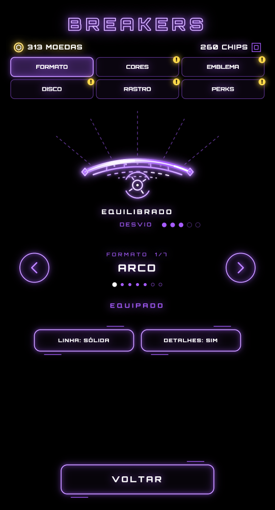<br><sub>Formatos e opções de estilo</sub></td>
<td align="center">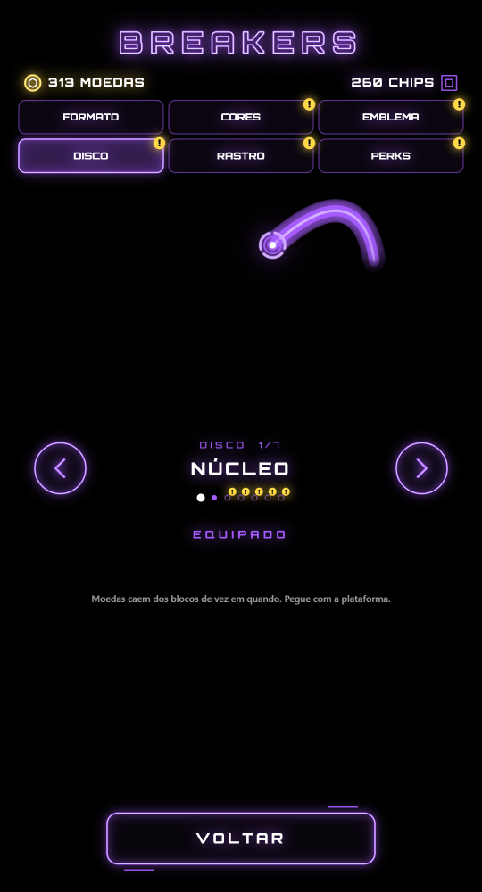<br><sub>Discos e rastros com prévia</sub></td>
<td align="center">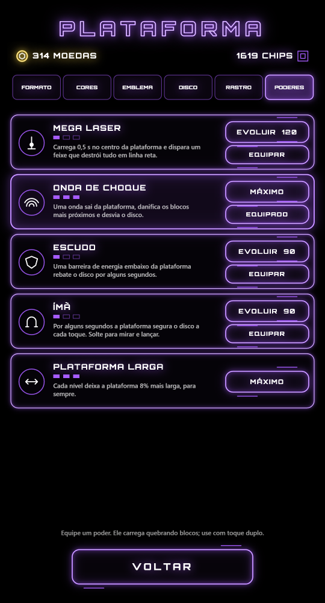<br><sub>Poderes evoluídos com chips</sub></td>
</tr>
</table>
</div>

| Moeda | Como ganhar | Serve para |
|---|---|---|
| **Chips** | 1 por bloco, 10 por fase, 5 por acerto no chefão, 60 por chefão | Comprar e evoluir os poderes da plataforma |
| **Moedas** | Caem de 7% dos blocos e precisam ser pegas com a plataforma | Cores, emblemas, discos e rastros |

## Controles

| Ação | Celular | Computador |
|---|---|---|
| Mover a plataforma | Tocar na tela e arrastar | Mouse, setas ou A / D |
| Lançar o disco | Soltar o dedo | Clique, espaço ou ↑ |
| Usar o poder da plataforma | Toque duplo ou botão na tela | E ou Shift |
| Pausar | Botão no canto superior direito | Esc ou P |

## Como rodar

O jogo está publicado no GitHub Pages: **https://costardiv1.github.io/neon-breaker/**

Para rodar localmente, precisa apenas do [Node.js](https://nodejs.org) (o jogo não tem dependências).

```bash
git clone https://github.com/costardiv1/neon-breaker.git
cd neon-breaker
npm start
```

Abra **http://localhost:5173**. Para jogar no celular, conecte-o à mesma rede Wi-Fi e abra o endereço “no celular” que o servidor mostra ao iniciar. No Chrome, “Adicionar à tela inicial” abre o jogo em tela cheia.

## Estrutura

```
www/
  index.html        página única com o canvas
  js/main.js        app: cenas, menus, mapa isométrico, entrada, persistência, modo dev
  js/game.js        classe Game: física, blocos, cápsulas, moedas, poderes, HUD
  js/boss.js        classe Boss e os chefões
  js/levels.js      dados dos 10 distritos, fases e mecânicas
  js/platform.js    formatos, paletas, emblemas e o desenho da plataforma
  js/audio.js       efeitos e músicas sintetizados (Web Audio)
  js/render.js      utilitários de desenho neon
server.js           servidor estático para testes
docs/               documentação, changelog, diagramas e capturas
```

A física roda em passo fixo de 120 Hz; o desenho usa coordenadas lógicas de 720 px de largura e sprites em cache.

## Documentação

- 📘 [Documentação do jogo (Word)](docs/Neon_Breaker_Documentacao.docx): regras, distritos, chefões, economia, arquitetura, diagrama de casos de uso e diagramas de classe.
- 📝 [Changelog (Word)](docs/CHANGELOG.docx) e [CHANGELOG.md](CHANGELOG.md): da 0.1 alpha até a 1.0.
- 🧩 Diagramas: [casos de uso](docs/diagramas/uc_resumido.png) · [módulos](docs/diagramas/classes_modulos.png) · [Game](docs/diagramas/classes_game.png) · [chefões](docs/diagramas/classes_chefoes.png) · [áudio](docs/diagramas/classes_audio.png)

<div align="center">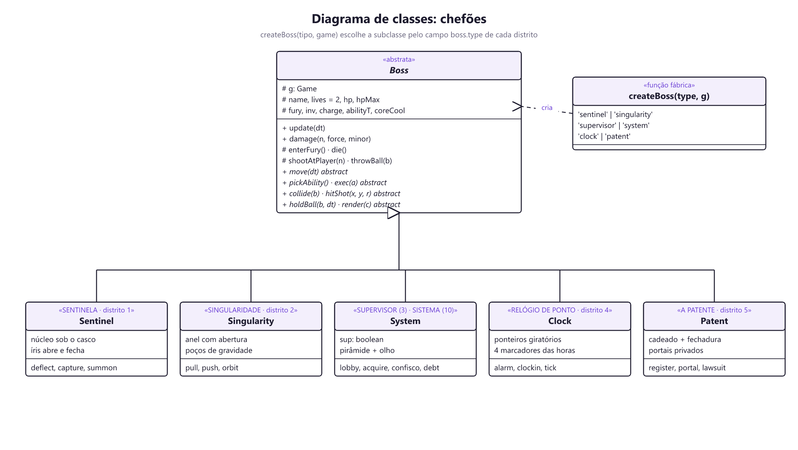</div>

## Créditos

Feito por **Vinícius Costardi** e **Claude Code**, desenvolvido em vibe code.

| Asset de terceiros | Licença |
|---|---|
| [Orbitron](https://fonts.google.com/specimen/Orbitron) (Matt McInerney), via Google Fonts | SIL Open Font License 1.1 |
| Textos: fonte do sistema (Segoe UI, Roboto ou Helvetica) | do próprio dispositivo |
| Gráficos, efeitos, sons e músicas | gerados por código no próprio jogo |

Inspirado nos quebra-blocos clássicos e na estética neon de Tron.

## Próximos passos

- [ ] Distritos 6 a 10 e a luta final contra O SISTEMA
- [ ] APK com Capacitor e publicação na Play Store
- [ ] Fonte Orbitron embutida no projeto
- [ ] Idiomas (PT / EN)

---

<div align="center"><sub>Feito com canvas, neon e muita madrugada.</sub></div>
